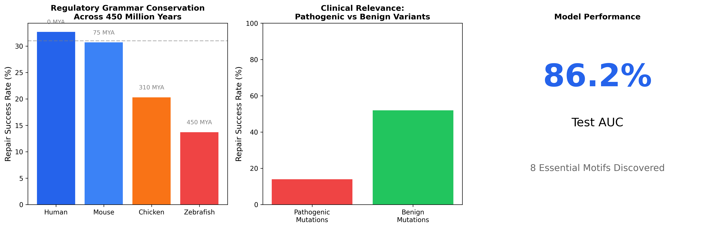
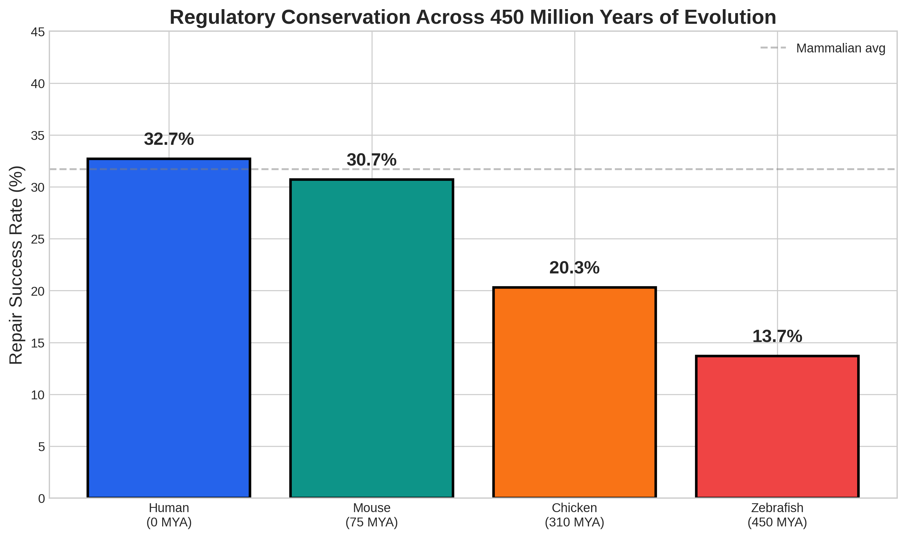
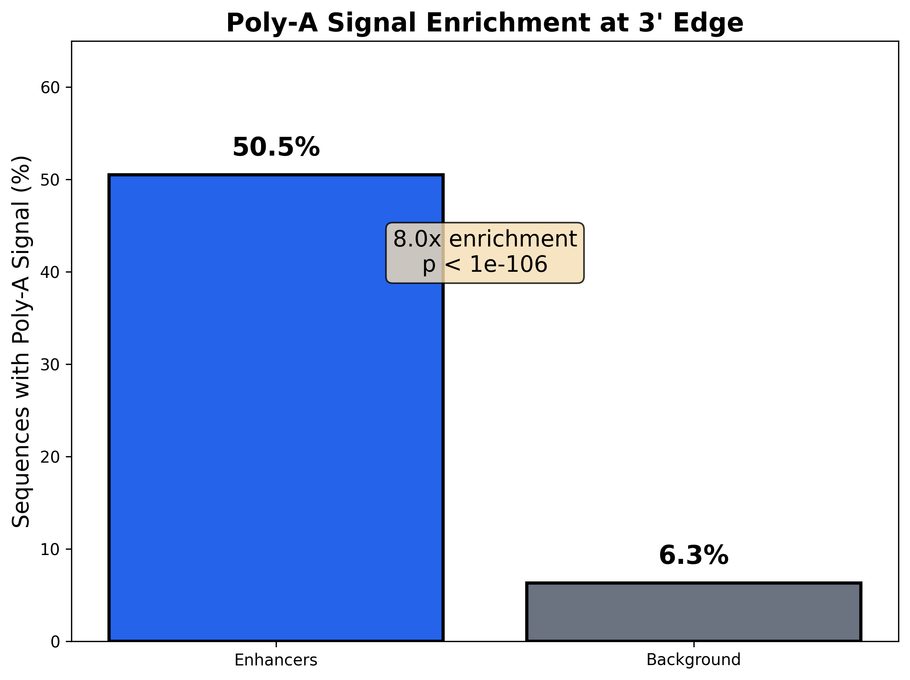
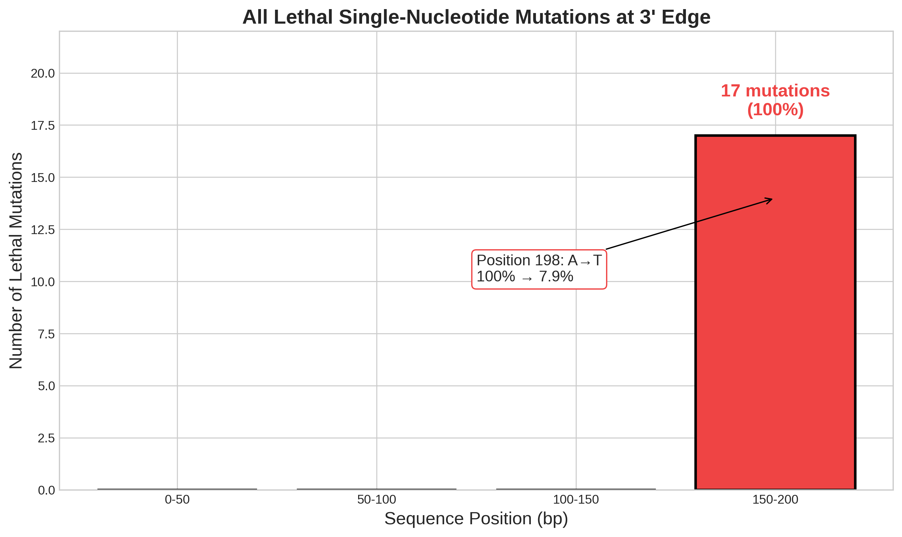
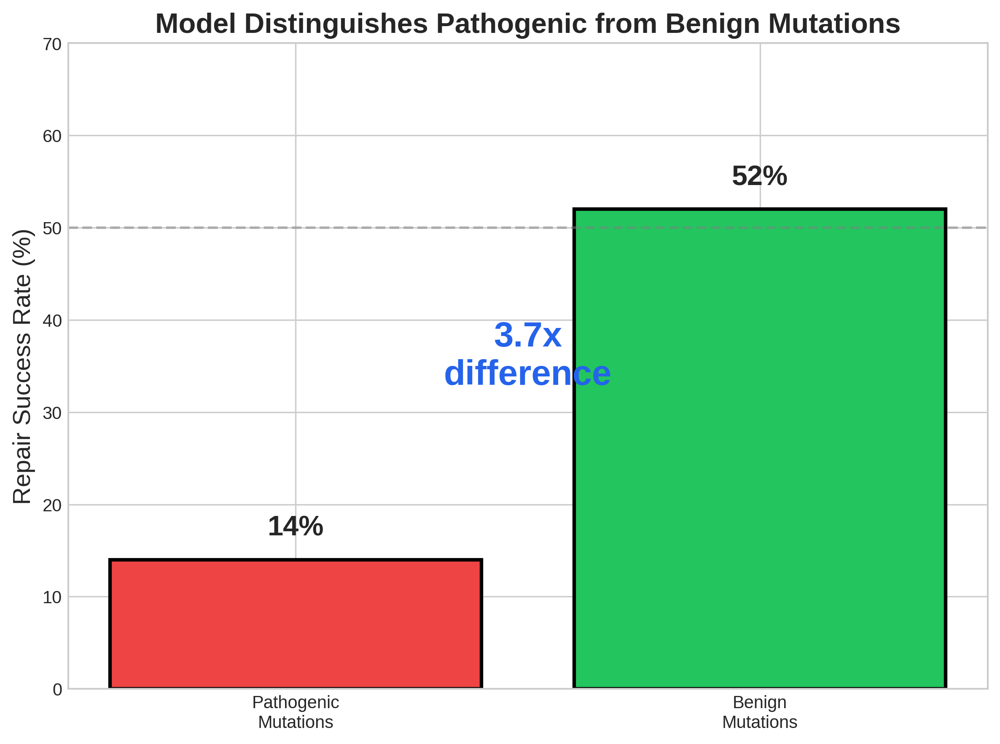
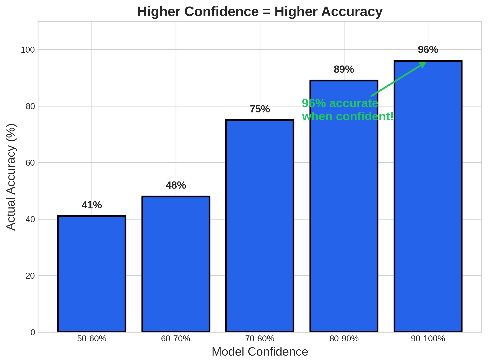
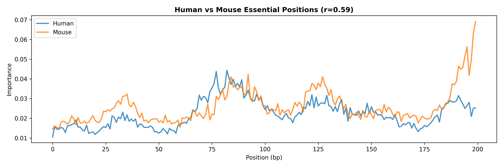
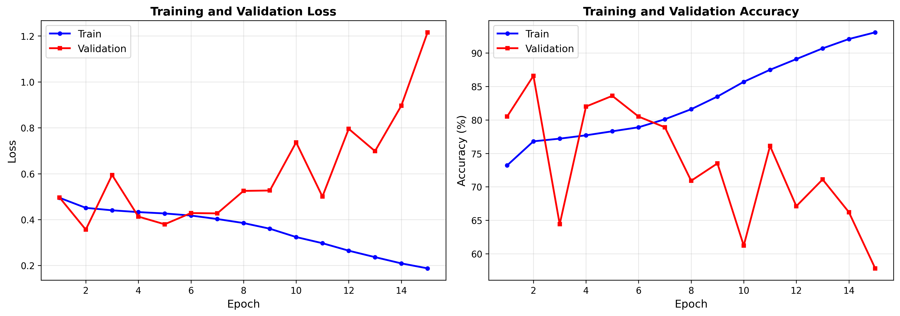

# Enhancer Repair Research: AI-Driven Discovery of Regulatory DNA Grammar

[](https://www.python.org/downloads/)
[](https://pytorch.org/)
[](LICENSE)



## Overview

Enhancers are short stretches of DNA that control when, where, and how strongly genes are turned on. Mutations in them are linked to cancer, developmental disorders, and other diseases, yet we still don't have a clear picture of the rules that make an enhancer work. Mapping those rules in the lab is slow and expensive.

This project takes a computational shortcut. We train a neural network to tell real enhancers apart from background DNA, then deliberately damage enhancer sequences and ask the model to repair them. The idea is simple: if the model can easily repair a change, that part of the sequence probably wasn't essential. If it can't, we've likely hit something the enhancer needs to function. Ranking positions by how often repair fails gives us a map of which parts of an enhancer matter most.

### Research question

Can a neural network's ability to repair mutated DNA reveal the regulatory grammar of enhancers?

### Hypotheses

1. The model will be able to repair random mutations but will fail to repair mutations in required patterns (motifs).
2. Regions with less than 50% repair success will match known transcription factor binding sites more often than regions with more than 80% repair success.

## Key Findings

| Finding | Result |
|---|---|
| Enhancer classification | Test ROC AUC of **0.862**, balanced accuracy of **77.4%** |
| Poly-A signal at the 3' edge | Found in 50.5% of enhancers vs. 6.3% of background (**8.0x enrichment**, p = 5.25e-106) |
| Pathogenic vs. benign mutations | Pathogenic mutations were repaired 14% of the time, benign ones 52% (**3.7x difference**) |
| Single-base "lethal" mutations | **17** found, all within the last 50 bases (positions 150 to 200) |
| Known motif matches | **55%** of top motifs match JASPAR entries, including the TATA-box, GC-box (Sp1), CAAT-box, and Poly-A signal |
| Human vs. mouse conservation | Essentiality maps correlate at **r = 0.59** (p = 2.4e-20) |
| Confidence calibration | When the model is 90 to 100% confident, it is right **96%** of the time |

A few of these deserve more explanation.

**The model found the Poly-A signal on its own.** Nobody told the model what a Poly-A signal is, but repair consistently failed at the 3' edge of enhancers, and the consensus sequence at positions 195 to 199 turned out to be AAAAA. Position 198 is especially sensitive. Keeping an A there preserves 82.9% of enhancer function, while swapping in a T drops it to 62.4%. The single worst mutation we found (A to T at position 198) cut the model's enhancer probability from 100% to about 8%.

**Repair separates harmful mutations from harmless ones.** Mutations labeled pathogenic were repaired far less often than benign ones (14% vs. 52%). After a deletion or a Poly-A disruption, sequences kept only 58% and 59% of their predicted function, while random point mutations left function fully intact.

**Simpler enhancers tend to be stronger.** Sequence complexity was negatively correlated with enhancer strength (r = -0.31, p = 1.5e-12), and strong enhancers had slightly lower GC content than weak ones (44.4% vs. 47.8%).

### Results that didn't pan out

We think these are worth reporting just as much as the positive results.

- **No motif interactions.** We tested all 28 pairs among the 8 essential motif regions and every pair behaved independently. We found no synergistic or redundant pairs, so at this resolution the model doesn't show combinatorial grammar.
- **Generated enhancers didn't look natural.** Starting from random DNA, the repair algorithm produced sequences the model classified as enhancers 22.5% of the time (45 of 200). However, their GC content (51.7%) was clearly higher than real enhancers (43.9%, KS test p < 0.0001), so this validation step failed.
- **Overfitting after epoch 5.** Training accuracy kept climbing to 93%, but validation balanced accuracy peaked at epoch 5 (77.4%) and declined after that. All results above use the epoch 5 checkpoint.
- **Low precision.** Enhancers make up only about 10% of the data, so even with a recall of 0.70, precision on the test set is 0.36 (F1 = 0.47).

## Cross-Species Results

We ran the repair test on 300 enhancers from each of four species. Repair rates were highest in mammals and dropped with evolutionary distance from humans, which is what you'd expect if the model mostly learned mammalian regulatory rules.

| Species | Repaired | Repair rate | Approx. divergence from human |
|---|---|---|---|
| Human | 98 / 300 | 32.7% | n/a |
| Mouse | 92 / 300 | 30.7% | ~90 million years |
| Chicken | 61 / 300 | 20.3% | ~310 million years |
| Zebrafish | 41 / 300 | 13.7% | ~430 million years |



## Methods

### Data

- **Enhancers:** 147,707 sequences, 200 bp each. Human (78,306) and mouse (59,424) come from ENCODE candidate cis-regulatory elements, and chicken (7,139) and zebrafish (2,838) come from Ensembl regulatory features.
- **Background:** 1,270,009 GC-matched genomic regions used as negative examples.
- **Splits:** 70% train (992,967), 15% validation (212,091), 15% test (212,658).
- **Class balance:** Because enhancers are only about 10% of the data, training uses a `WeightedRandomSampler` so each batch is roughly balanced.

### Model

A hybrid CNN-Transformer with 43.6M parameters. Convolutional layers with several kernel sizes pick up short motifs, and a transformer encoder (24 layers, 16 attention heads, model dimension 1024) captures longer-range relationships between them. The model was trained for 15 epochs on an NVIDIA A100 (80 GB) in Google Colab, with mixed precision, a learning rate of 1e-4, a batch size of 64, and random seed 42.

### Analysis pipeline

1. Train the model to classify enhancers against background DNA.
2. Damage enhancer sequences with random point mutations (10% of positions).
3. Try to repair each damaged sequence using gradient-based optimization.
4. Mark positions where repair repeatedly fails as essential.
5. Compare the essential regions against the JASPAR transcription factor database.
6. Repeat across species, test pairs of motifs for interactions, and try generating enhancers from random DNA.

## Repository Structure

```
MotifResearch/
├── notebooks/
│   └── enhancer_repair_pipeline.ipynb   Full pipeline, with saved outputs from the final run
├── data/
│   ├── raw/                             Source BED files (chicken, zebrafish)
│   └── processed/                       Enhancer and background sequences for each species (JSONL)
├── results/
│   ├── tables/                          CSV tables (model performance, cross-species, grammar, generative)
│   ├── cross_species/, grammar/,        Raw analysis outputs (pickle)
│   │   generative/
│   ├── all_results.pkl
│   └── RESEARCH_SUMMARY_REPORT.md       Auto-generated summary of the run
├── final_results/
│   ├── TOP_10_FINDINGS.md
│   ├── BOARD_CONTENT.md                 Text used on the science fair board
│   ├── complete_statistics.json         Every number reported above
│   └── training_history.json            Loss and accuracy for each epoch
├── figures/                             All figures (PNG)
├── docs/                                Downloader guide and science fair board
├── scripts/download_sequences.py        Downloads sequences from Ensembl for a BED file
├── src/                                 Earlier modular version of the code (the notebook doesn't import it)
└── configs/, requirements.txt
```

### Files not included

These files go over GitHub's 100 MB limit, so they aren't in the repo:

- Trained model weights (`final_model.pt`, 171 MB) and training checkpoints
- The encoded dataset (`dataset.npz`, 221 MB)
- `data/processed/human_backgrounds.jsonl` (223 MB)

The notebook rebuilds the encoded dataset and the train/val/test splits from the JSONL files.

## Running the Notebook

1. Open `notebooks/enhancer_repair_pipeline.ipynb` in Google Colab.
2. Set the runtime to a GPU (`Runtime` > `Change runtime type`). The notebook detects the GPU and picks a model size to match. An A100 was used for the reported results, and smaller GPUs will fall back to a smaller model.
3. Put the files from `data/processed/` in `MyDrive/enhancer_repair_research/data/processed/` on Google Drive, which is where the notebook looks for them.
4. Run the cells in order. Checkpoints are saved to Drive, so if Colab times out you can resume where you left off.

To run it locally instead:

```bash
git clone https://github.com/yilangsu/MotifResearch.git
cd MotifResearch
pip install -r requirements.txt
jupyter notebook notebooks/enhancer_repair_pipeline.ipynb
```

## Figures

| | |
|---|---|
|  |  |
|  |  |
|  |  |

More figures, including grammar discovery, generative validation, essentiality maps, and mutation robustness, are in [`figures/`](figures/).

## Acknowledgments

- The [ENCODE Project](https://www.encodeproject.org/) for human and mouse regulatory annotations
- [Ensembl](https://www.ensembl.org/) for chicken and zebrafish regulatory features
- [JASPAR](https://jaspar.elixir.no/) for transcription factor binding profiles
- Google Colab for GPU access

## License

MIT. See [LICENSE](LICENSE).
